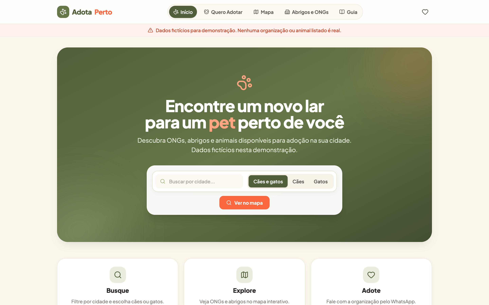
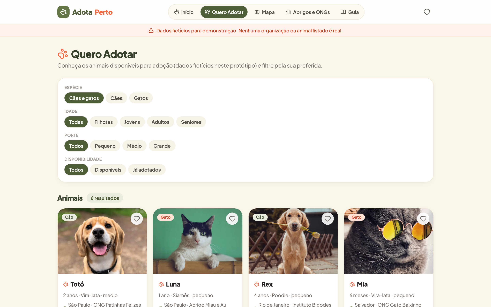
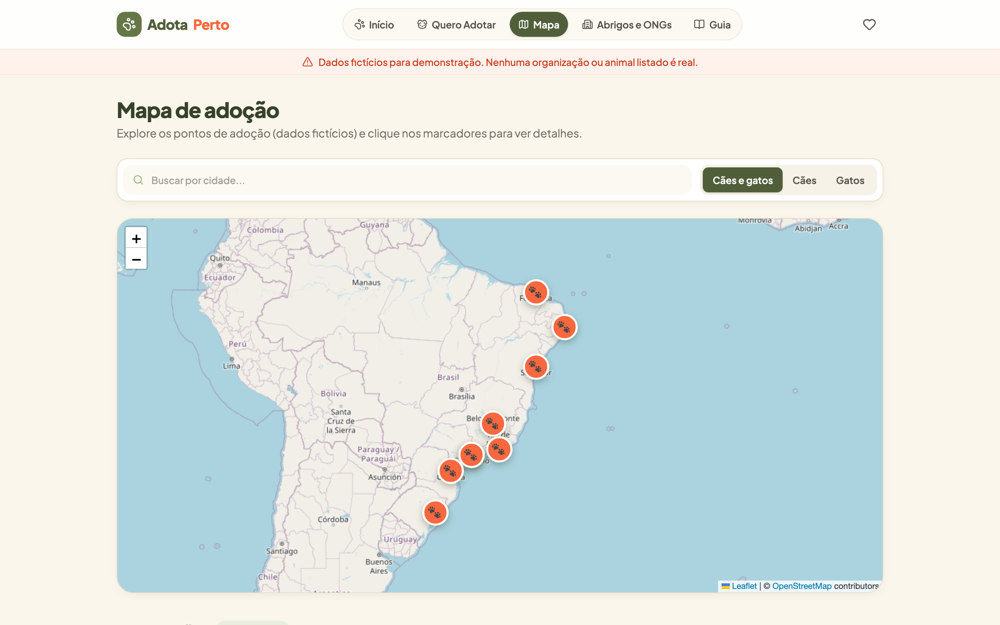

# AdotaPerto

**Encontre ONGs, abrigos e animais disponíveis para adoção de cães e gatos perto de você.**

AdotaPerto é uma aplicação web que conecta pessoas interessadas em adoção a pontos de adoção responsáveis em sua cidade. O usuário pode buscar por cidade e espécie, explorar organizações em um mapa interativo, conhecer os animais disponíveis, salvar favoritos e entrar em contato com as ONGs direto pelo WhatsApp.

> **Protótipo com dados fictícios** — organizações, animais, endereços, telefones e histórias são inventados para demonstração. Nenhum contato é real.

> Desenvolvido por **elosruiz** com o grupo do Hack Brasil para testar a IA Devin.

## Funcionalidades

| Área | Descrição |
| --- | --- |
| Busca | Filtros por cidade e espécie (cães/gatos) na home |
| Quero Adotar | Catálogo de animais com filtros por espécie, faixa etária, porte e disponibilidade |
| Mapa | Mapa interativo (Leaflet/OpenStreetMap) com marcadores das organizações e rotas |
| Favoritos | Coração nos cards/detalhe, persistidos em `localStorage`, com página dedicada e contador na navbar |
| Perto de Mim | Geolocalização sob demanda, distância em linha reta (Haversine) e link de rota para o Google Maps |
| Detalhes | Páginas completas de animal e organização com fotos, atributos e contatos (`tel:`, `mailto:`) |
| Tenho Interesse | Formulário que monta uma mensagem de WhatsApp para a ONG, sem armazenar dados pessoais |
| Guia | Conteúdo educativo sobre adoção responsável |
| Histórias | Relatos de adoção fictícios, claramente identificados |

## Tecnologias

- **React 19** + **TypeScript** + **Vite**
- **Tailwind CSS 4** (tema customizado sálvia/coral/creme)
- **react-router-dom 7** com `HashRouter` (funciona em hospedagem estática)
- **react-leaflet + Leaflet** para os mapas
- **lucide-react** para ícones
- **oxlint** para lint

## Instalação e execução

Pré-requisito: [Node.js](https://nodejs.org) 18+.

```bash
npm install      # instala as dependências
npm run dev      # servidor de desenvolvimento (http://localhost:5173)
```

Outros comandos:

```bash
npm run build    # typecheck (tsc) + build de produção em dist/
npm run preview  # serve o build de produção localmente
npm run lint     # executa o oxlint
```

## Screenshots

> Adicione imagens do site aqui após publicar (ex.: `docs/screenshots/home.png`).

| Home | Quero Adotar | Mapa |
| --- | --- | --- |
|  |  |  |

## Estrutura do projeto

```
src/
  components/    # UI reutilizável (cards, filtros, mapa, formulário, favorito)
  components/map # mapa Leaflet
  data/          # dados fictícios (mockData, histórias)
  lib/           # dataSource, favoritos, geolocalização, geo, utils
  pages/         # uma página por rota
  types.ts       # tipos compartilhados (Organizacao, Animal, filtros)
```

## Publicação

O build é estático (`npm run build` → `dist/`) e pode ser publicado em qualquer hospedagem estática (GitHub Pages, Netlify, Vercel). O `HashRouter` elimina a necessidade de configuração de fallback de SPA.

## Roadmap

- [ ] Integrar backend real (Supabase) via `src/lib/dataSource.ts`
- [ ] Cadastro de ONGs e animais por administradores
- [ ] Filtros por raça, gênero e distância
